# Итоговый комплект для презентации — 28.10.2026

Полная серия обновлённого алгоритма завершена. **7838 реальных запусков**,
36.30 минут локального расчёта. Все таблицы и графики
в этом каталоге относятся к одной версии алгоритма и одной методике.

## Независимая контрольная проверка

| Класс | Обычный ГА, ошибка | Островной ГА, ошибка | Без поиска по потомкам | Обычный / островной, мс |
|---|---:|---:|---:|---:|
| Малые | 7.52% | 7.07% | 16.27% | 35.7 / 29.2 |
| Средние | 19.90% | 18.38% | 29.29% | 60.7 / 39.0 |
| Большие | 2.80% | 3.07% | 5.67% | 897.3 / 874.0 |

Ошибка: 100 × (стоимость ГА − точный оптимум SciPy) / точный оптимум.
«Без поиска по потомкам» отличается от обычного варианта только выключением
`local_on_offspring`; если TRAIN сам выключил этот флаг, варианты совпадают.
Одинаковое число локальных вызовов не означает одинаковое фактическое время.

## Что можно утверждать на защите

- Исследованы инверсия, RSS/ранговый RSS, элитизм, парные и тройные обмены,
  локальный поиск по потомкам и настоящие параллельные острова.
- Пара обычный/островной имеет одинаковые N, G, параметры локального поиска
  и фактическую глобальную квоту локальных вызовов. Различаются только острова
  и миграция; измеренное время включает передачу данных и миграцию.
- Меньшая ошибка больших матриц зависит от диапазона стоимостей 1–100 и
  количества равноценных дешёвых назначений. Это не доказательство того,
  что большие задачи вообще проще. Отдельные графики `common_settings_*`
  фиксируют одинаковые настройки для всех размеров и отделяют этот эффект
  от настройки классов.
- Слабое влияние некоторых параметров — результат измерений. Близкие линии
  не доказывают отсутствие эффекта; в таблице парных разностей сохранены
  изменения ошибки и времени на одних матрицах.
- Лучшие настройки — лучшие в ограниченном последовательном TRAIN-поиске,
  а не глобальные оптимумы и не гарантия качества на другом семействе данных.

## Методика

TRAIN: 1026 запусков, по 3 размера и 2 независимые матрицы каждого
класса. Один координатный проход: в каждом сравнении меняется одно поле.
Текущий уровень всегда входит в сравнение; на равенстве сохраняется текущий.
После обучения настройки заморожены в `selected.json`.

SURVEY: 6440 запусков, 46 размеров × **2 независимые матрицы**.
Малые 10–90, шаг 10; средние 100–475, шаг 25; большие 500–950, шаг 50,
1000–2000, шаг 100. Строгий OFAT по 21 параметру, плюс
парные обычный/островной и общий для всех классов базовый вариант.
Точки кривых — средние измеренных запусков на данном размере.
Условные параметры исследованы в активном фиксированном контексте:
степень рангов при ранговом RSS, управляющие поля адаптации при включённой
адаптации, параметры миграции при нескольких островах и ненулевой доле
мигрантов для исследования интервала. Полный контекст сохранён в каждой строке.

HOLDOUT: 360 запусков, 12 размеров × **5 независимых матриц**,
6 вариантов. Они не участвовали в выборе параметров. Диагональная проверка:
12 запусков, во всех найден точный оптимум n.
Seed всех этапов непересекаются и отличаются от предыдущих исследований.

Графики: Montserrat, все три класса на одном графике, подписи для презентации.
Плавное соединение PCHIP только оформляет измеренные средние и не создаёт
наблюдений. Ось X состоит из трёх непрерывных участков разного масштаба;
на части графиков ошибка показана с нелинейной шкалой. Эти пояснения вынесены
сюда и не загромождают рисунки. Базовые настройки OFAT различаются между
классами; переход между ними не является отдельным наблюдением.

Времена получены с прогретыми функциями и общим переиспользуемым пулом
из четырёх процессов. Создание пула и SciPy исключены, сериализация матриц
и миграция включены. Фоновая нагрузка ОС не контролировалась.

## Материалы

[Лучшие параметры](best_parameters.csv) · [Контрольные итоги](holdout_summary.csv)
· [Чувствительность](ofat_sensitivity.csv) · [Парные эффекты](paired_parameter_effects.csv)
· [Аудит](audit.json) · [Параметры и seed](metadata.json).

## Графики сравнения

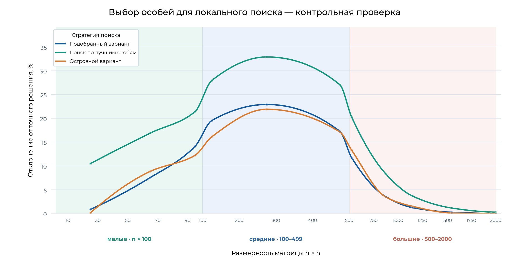

[Контроль SVG](plots/holdout_offspring.svg) · [Качество обычного/островного](plots/paired_survey_error_pct.png)
· [Время](plots/paired_survey_seconds.png) · [Общие настройки](plots/common_settings_error_pct.png).

## Число поколений

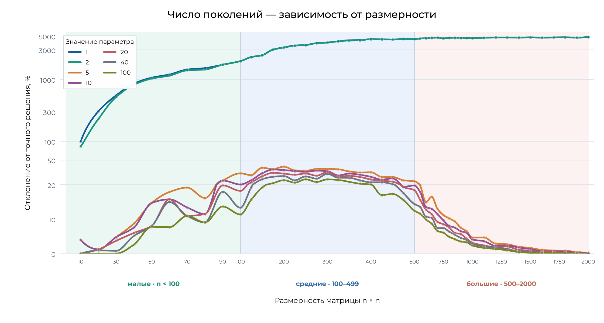

[PNG](plots/ofat_generations_error_pct.png) · [SVG](plots/ofat_generations_error_pct.svg) · [Время PNG](plots/ofat_generations_seconds.png) · [Время SVG](plots/ofat_generations_seconds.svg).

## Общая популяция

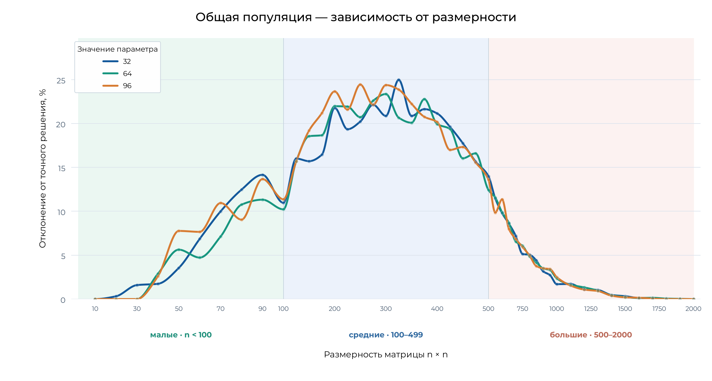

[PNG](plots/ofat_population_error_pct.png) · [SVG](plots/ofat_population_error_pct.svg) · [Время PNG](plots/ofat_population_seconds.png) · [Время SVG](plots/ofat_population_seconds.svg).

## RSS: исходный / ранговый

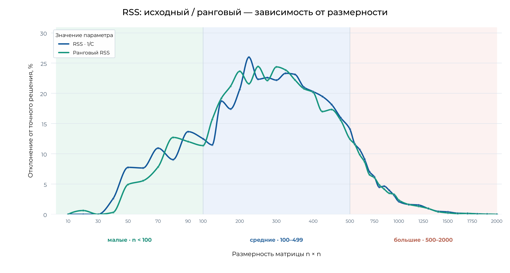

[PNG](plots/ofat_selection_error_pct.png) · [SVG](plots/ofat_selection_error_pct.svg) · [Время PNG](plots/ofat_selection_seconds.png) · [Время SVG](plots/ofat_selection_seconds.svg).

## Степень рангового RSS

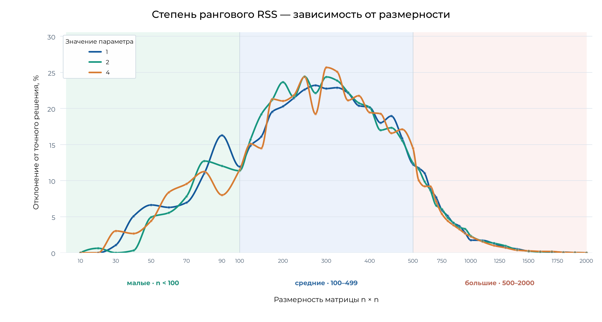

[PNG](plots/ofat_rank_power_error_pct.png) · [SVG](plots/ofat_rank_power_error_pct.svg) · [Время PNG](plots/ofat_rank_power_seconds.png) · [Время SVG](plots/ofat_rank_power_seconds.svg).

## Вероятность мутации

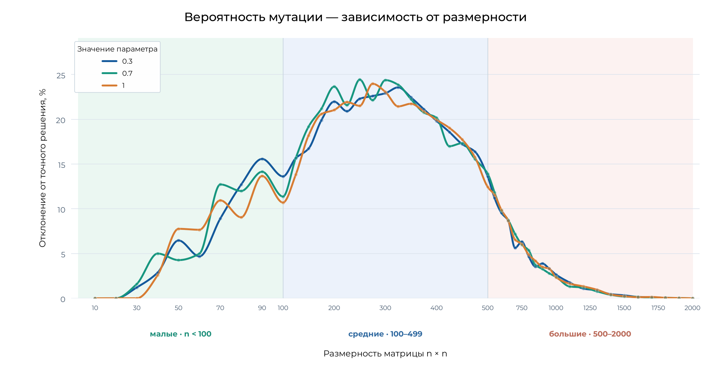

[PNG](plots/ofat_mutation_prob_error_pct.png) · [SVG](plots/ofat_mutation_prob_error_pct.svg) · [Время PNG](plots/ofat_mutation_prob_seconds.png) · [Время SVG](plots/ofat_mutation_prob_seconds.svg).

## Максимальная длина инверсии, %

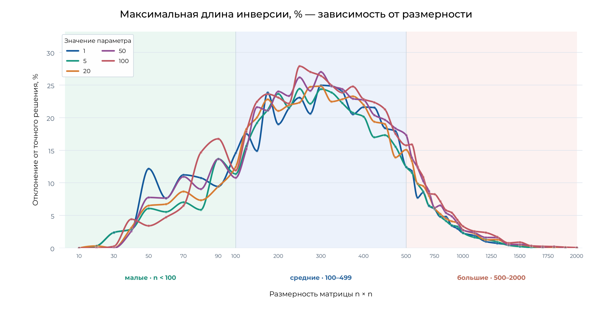

[PNG](plots/ofat_inversion_pct_error_pct.png) · [SVG](plots/ofat_inversion_pct_error_pct.svg) · [Время PNG](plots/ofat_inversion_pct_seconds.png) · [Время SVG](plots/ofat_inversion_pct_seconds.svg).

## Доля элиты

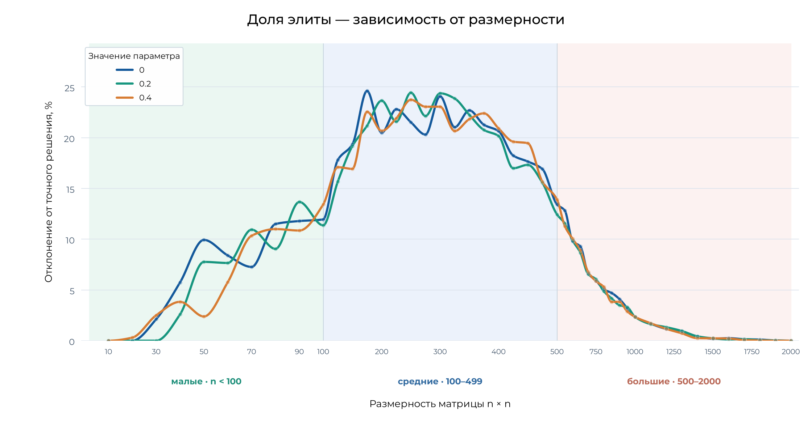

[PNG](plots/ofat_elitism_error_pct.png) · [SVG](plots/ofat_elitism_error_pct.svg) · [Время PNG](plots/ofat_elitism_seconds.png) · [Время SVG](plots/ofat_elitism_seconds.svg).

## Период локального поиска

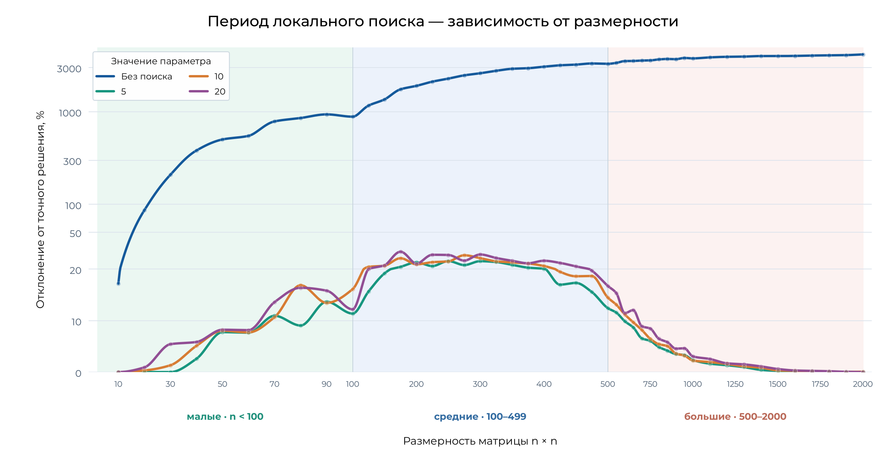

[PNG](plots/ofat_local_every_error_pct.png) · [SVG](plots/ofat_local_every_error_pct.svg) · [Время PNG](plots/ofat_local_every_seconds.png) · [Время SVG](plots/ofat_local_every_seconds.svg).

## Число кандидатов локального поиска

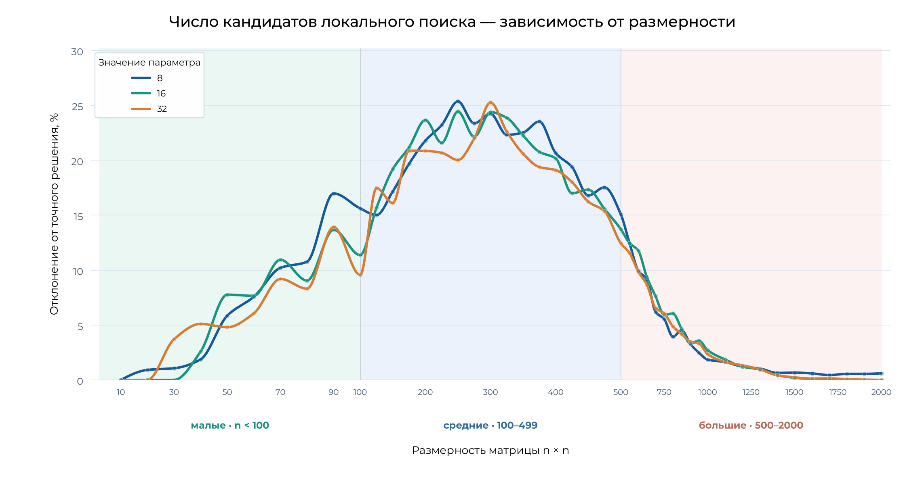

[PNG](plots/ofat_local_candidates_error_pct.png) · [SVG](plots/ofat_local_candidates_error_pct.svg) · [Время PNG](plots/ofat_local_candidates_seconds.png) · [Время SVG](plots/ofat_local_candidates_seconds.svg).

## Число проходов парных обменов

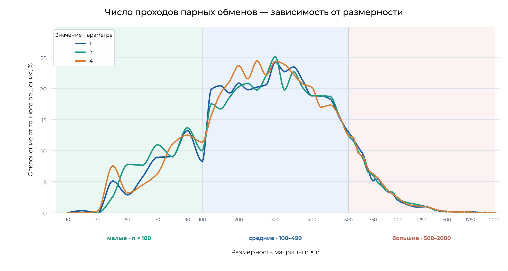

[PNG](plots/ofat_local_passes_error_pct.png) · [SVG](plots/ofat_local_passes_error_pct.svg) · [Время PNG](plots/ofat_local_passes_seconds.png) · [Время SVG](plots/ofat_local_passes_seconds.svg).

## Число особей для локального поиска

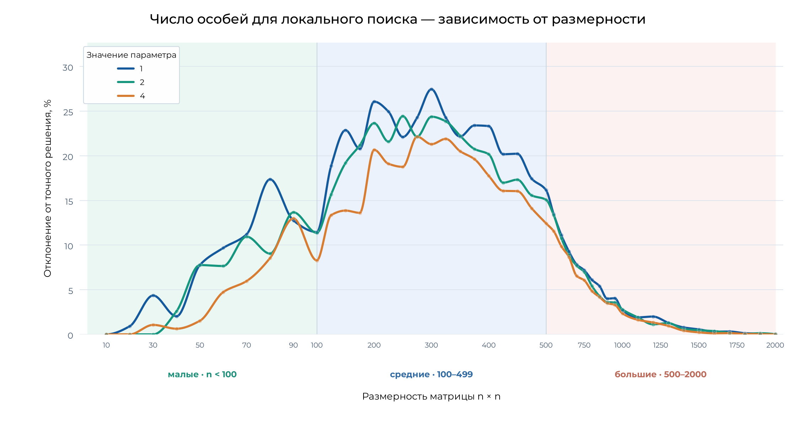

[PNG](plots/ofat_local_top_error_pct.png) · [SVG](plots/ofat_local_top_error_pct.svg) · [Время PNG](plots/ofat_local_top_seconds.png) · [Время SVG](plots/ofat_local_top_seconds.svg).

## Тройные обмены

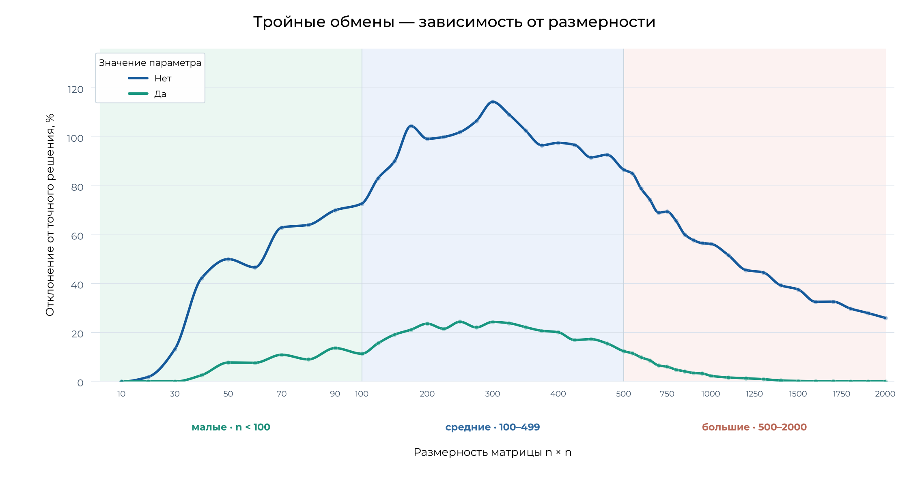

[PNG](plots/ofat_cycle3_error_pct.png) · [SVG](plots/ofat_cycle3_error_pct.svg) · [Время PNG](plots/ofat_cycle3_seconds.png) · [Время SVG](plots/ofat_cycle3_seconds.svg).

## Число проходов тройных обменов

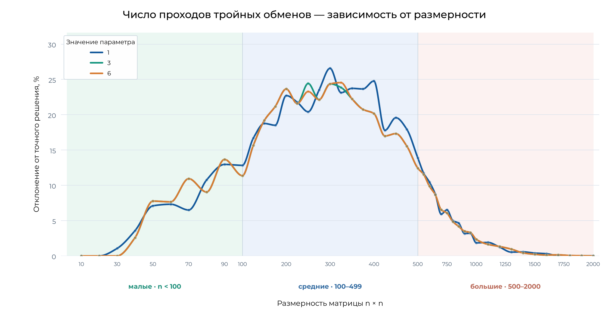

[PNG](plots/ofat_cycle3_passes_error_pct.png) · [SVG](plots/ofat_cycle3_passes_error_pct.svg) · [Время PNG](plots/ofat_cycle3_passes_seconds.png) · [Время SVG](plots/ofat_cycle3_passes_seconds.svg).

## Адаптивная инверсия

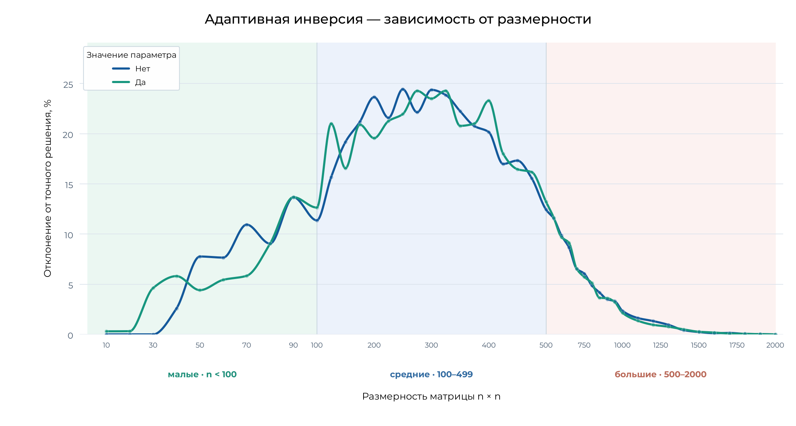

[PNG](plots/ofat_adaptive_error_pct.png) · [SVG](plots/ofat_adaptive_error_pct.svg) · [Время PNG](plots/ofat_adaptive_seconds.png) · [Время SVG](plots/ofat_adaptive_seconds.svg).

## Горизонт адаптации

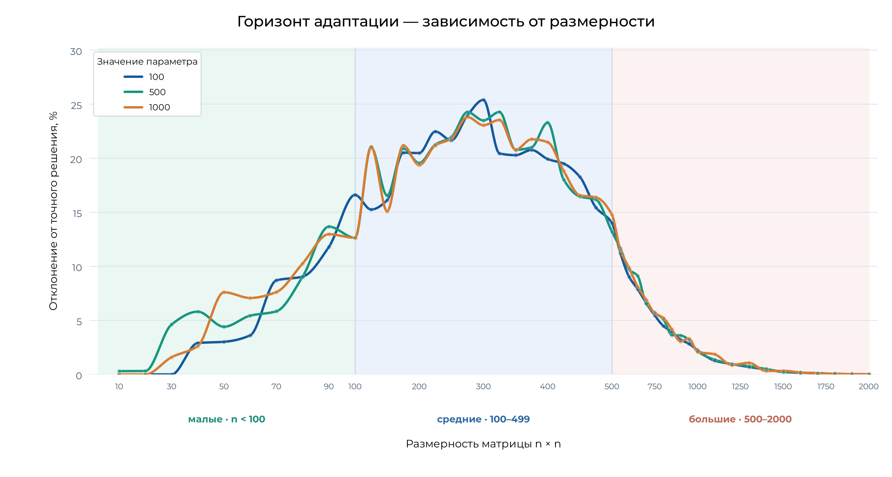

[PNG](plots/ofat_adaptive_horizon_error_pct.png) · [SVG](plots/ofat_adaptive_horizon_error_pct.svg) · [Время PNG](plots/ofat_adaptive_horizon_seconds.png) · [Время SVG](plots/ofat_adaptive_horizon_seconds.svg).

## Вероятность дополнительной инверсии

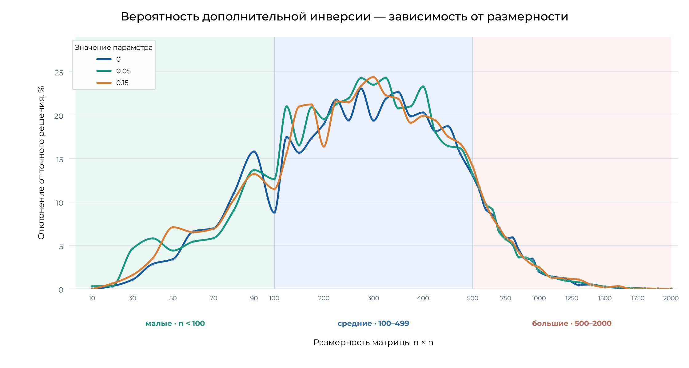

[PNG](plots/ofat_adaptive_long_prob_error_pct.png) · [SVG](plots/ofat_adaptive_long_prob_error_pct.svg) · [Время PNG](plots/ofat_adaptive_long_prob_seconds.png) · [Время SVG](plots/ofat_adaptive_long_prob_seconds.svg).

## Длина дополнительной инверсии, %

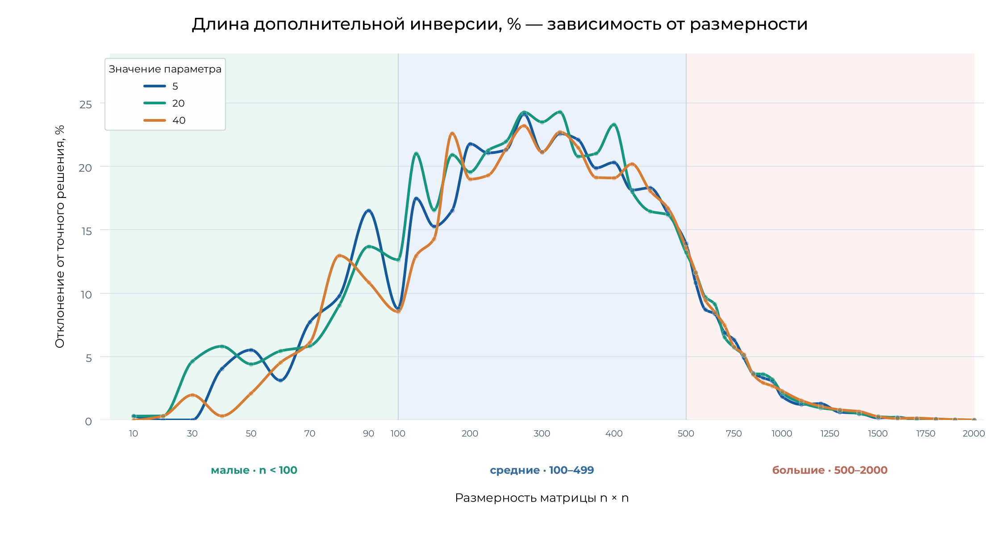

[PNG](plots/ofat_adaptive_long_pct_error_pct.png) · [SVG](plots/ofat_adaptive_long_pct_error_pct.svg) · [Время PNG](plots/ofat_adaptive_long_pct_seconds.png) · [Время SVG](plots/ofat_adaptive_long_pct_seconds.svg).

## Число островов

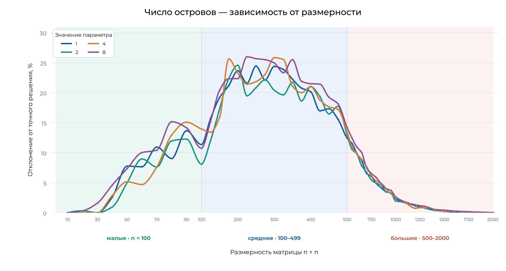

[PNG](plots/ofat_islands_error_pct.png) · [SVG](plots/ofat_islands_error_pct.svg) · [Время PNG](plots/ofat_islands_seconds.png) · [Время SVG](plots/ofat_islands_seconds.svg).

## Интервал кольцевой миграции

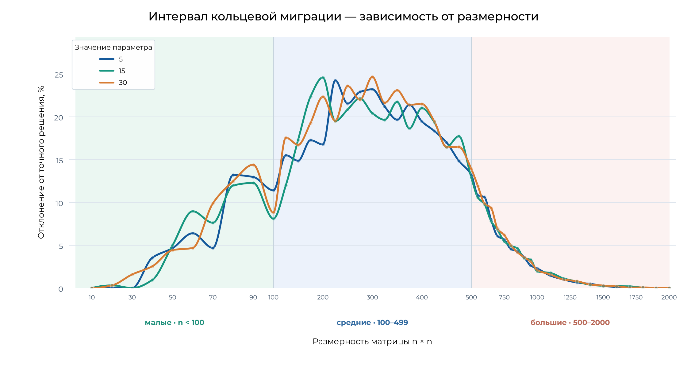

[PNG](plots/ofat_migration_interval_error_pct.png) · [SVG](plots/ofat_migration_interval_error_pct.svg) · [Время PNG](plots/ofat_migration_interval_seconds.png) · [Время SVG](plots/ofat_migration_interval_seconds.svg).

## Доля мигрантов

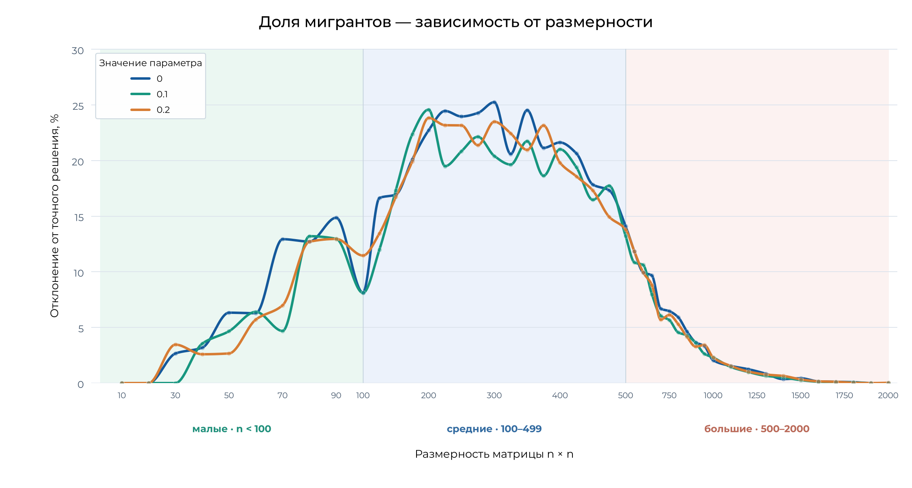

[PNG](plots/ofat_migration_pct_error_pct.png) · [SVG](plots/ofat_migration_pct_error_pct.svg) · [Время PNG](plots/ofat_migration_pct_seconds.png) · [Время SVG](plots/ofat_migration_pct_seconds.svg).

## Локальный поиск по потомкам

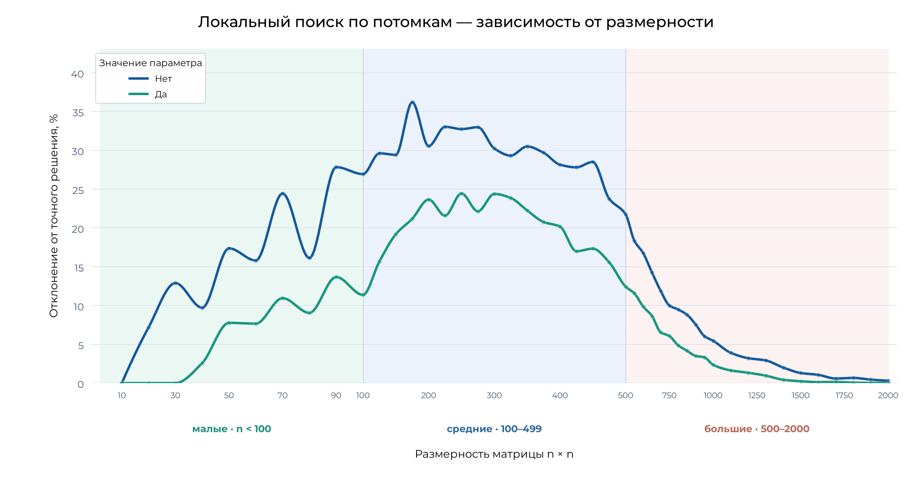

[PNG](plots/ofat_local_on_offspring_error_pct.png) · [SVG](plots/ofat_local_on_offspring_error_pct.svg) · [Время PNG](plots/ofat_local_on_offspring_seconds.png) · [Время SVG](plots/ofat_local_on_offspring_seconds.svg).

## Переносимость выбранных настроек

На независимом контроле общая конфигурация дала 5.05% на малых и 18.88% на средних, то есть оказалась точнее подобранных на TRAIN вариантов. Это показывает ограниченность координатного поиска и его обучающей выборки. Параметры по HOLDOUT не заменялись; этот результат сохранён как проверка переносимости.
