# Результаты локального исследования — 28.10.2026

[Методика, лучшие параметры и выводы](../../docs/local-work-research-20261028.md) · [Таблица параметров](best_parameters.csv) · [Контроль](holdout_summary.csv) · [Аудит](audit.json).

Все три класса на одном графике. Montserrat; точки — измерения, PCHIP — только плавное соединение.

## Основные результаты

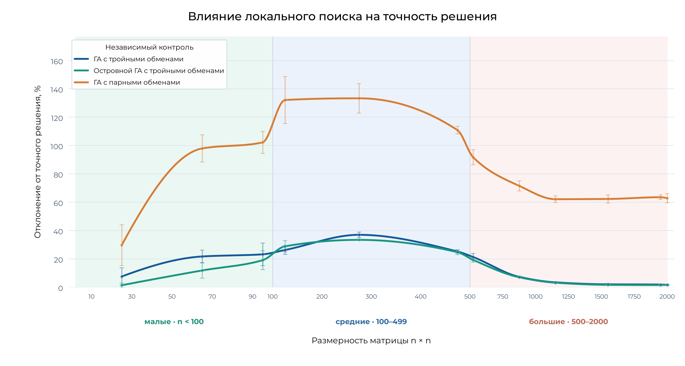

[SVG](plots/holdout_quality.svg) · [Сравнение качества](plots/paired_survey_error_pct.png) · [Сравнение времени](plots/paired_survey_seconds.png).

## Число поколений

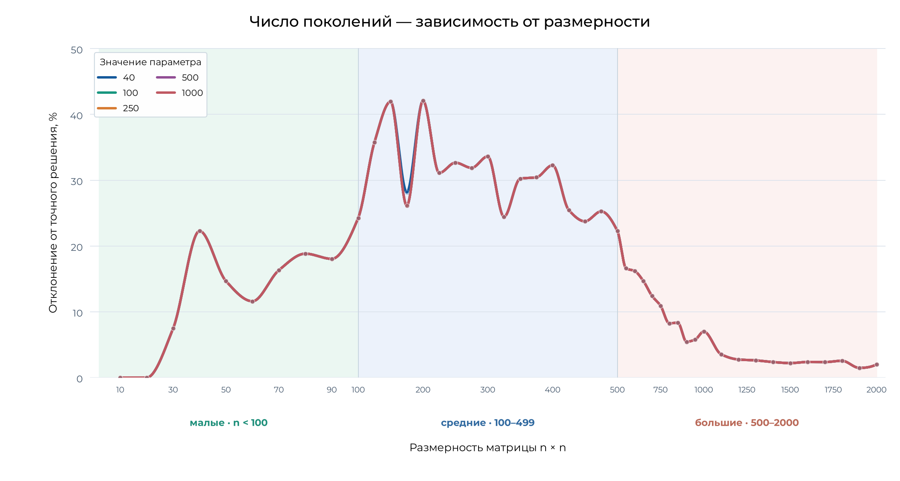

[PNG](plots/ofat_generations_error_pct.png) · [SVG](plots/ofat_generations_error_pct.svg) · [Время PNG](plots/ofat_generations_seconds.png) · [Время SVG](plots/ofat_generations_seconds.svg).

## Общая популяция

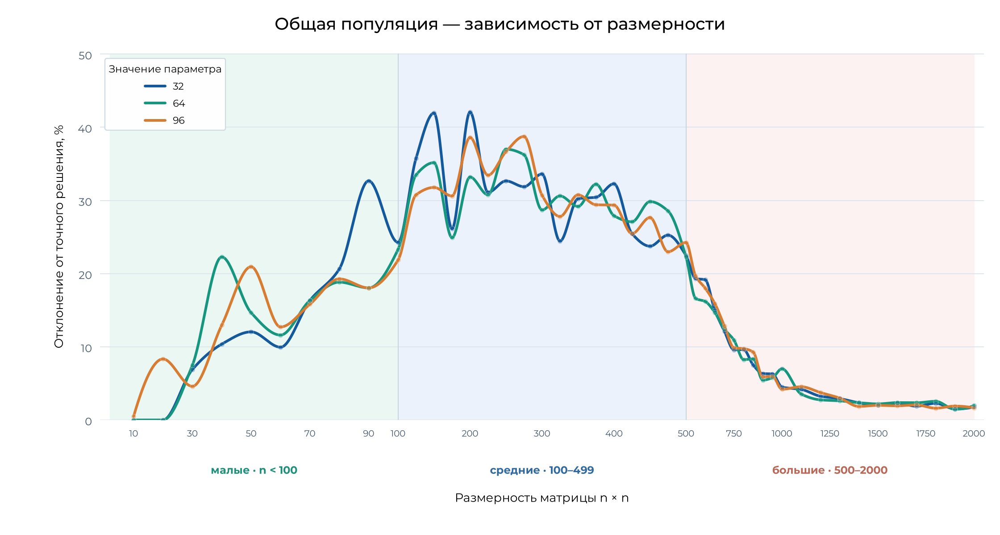

[PNG](plots/ofat_population_error_pct.png) · [SVG](plots/ofat_population_error_pct.svg) · [Время PNG](plots/ofat_population_seconds.png) · [Время SVG](plots/ofat_population_seconds.svg).

## RSS: исходный / ранговый

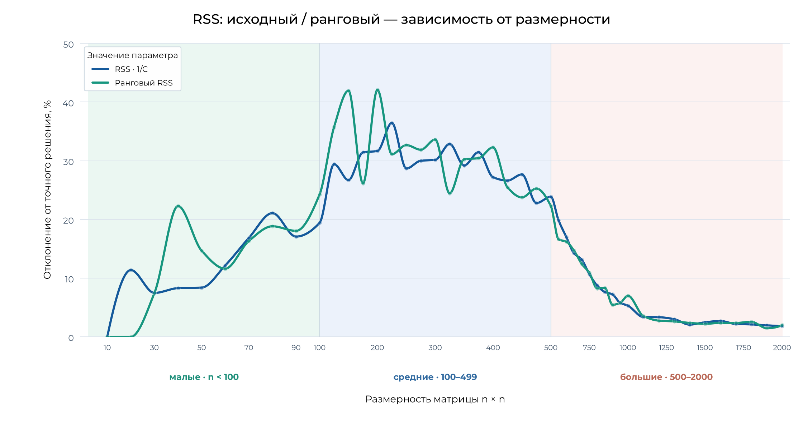

[PNG](plots/ofat_selection_error_pct.png) · [SVG](plots/ofat_selection_error_pct.svg) · [Время PNG](plots/ofat_selection_seconds.png) · [Время SVG](plots/ofat_selection_seconds.svg).

## Степень рангового RSS

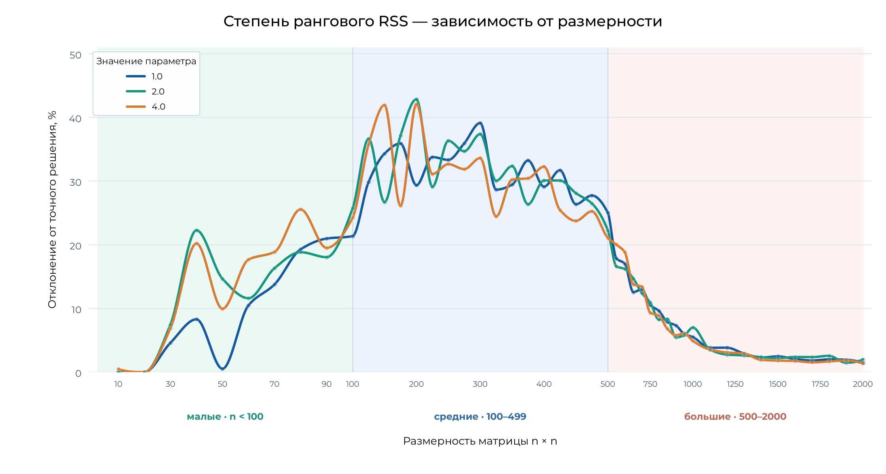

[PNG](plots/ofat_rank_power_error_pct.png) · [SVG](plots/ofat_rank_power_error_pct.svg) · [Время PNG](plots/ofat_rank_power_seconds.png) · [Время SVG](plots/ofat_rank_power_seconds.svg).

## Вероятность мутации

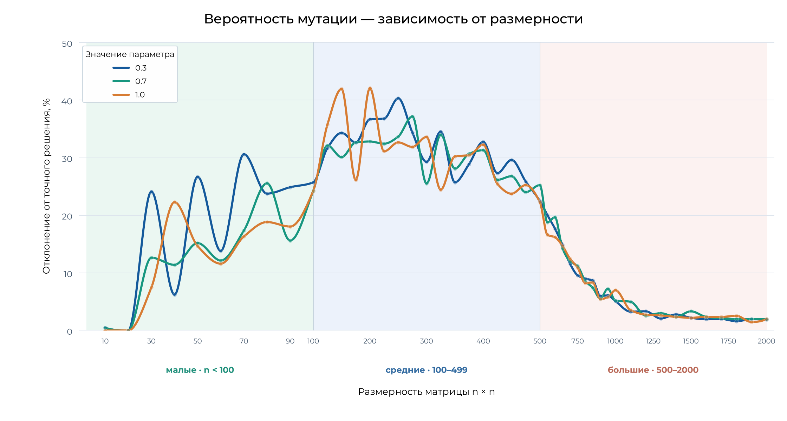

[PNG](plots/ofat_mutation_prob_error_pct.png) · [SVG](plots/ofat_mutation_prob_error_pct.svg) · [Время PNG](plots/ofat_mutation_prob_seconds.png) · [Время SVG](plots/ofat_mutation_prob_seconds.svg).

## Максимальная длина инверсии, %

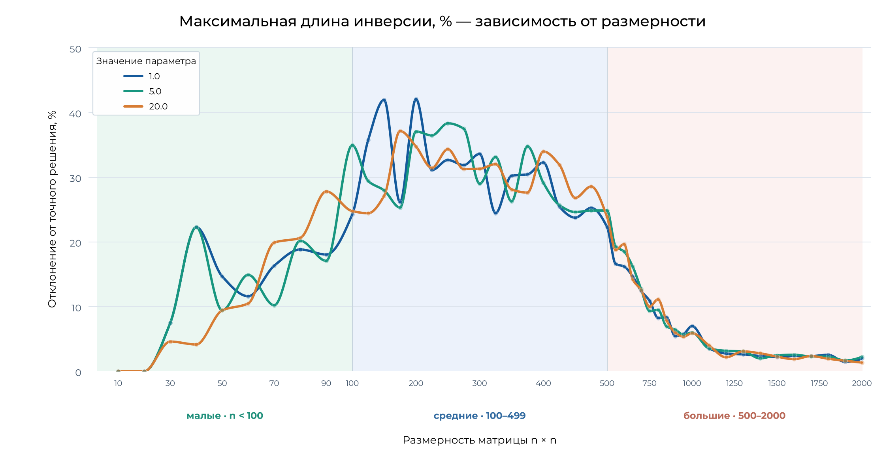

[PNG](plots/ofat_inversion_pct_error_pct.png) · [SVG](plots/ofat_inversion_pct_error_pct.svg) · [Время PNG](plots/ofat_inversion_pct_seconds.png) · [Время SVG](plots/ofat_inversion_pct_seconds.svg).

## Доля элиты

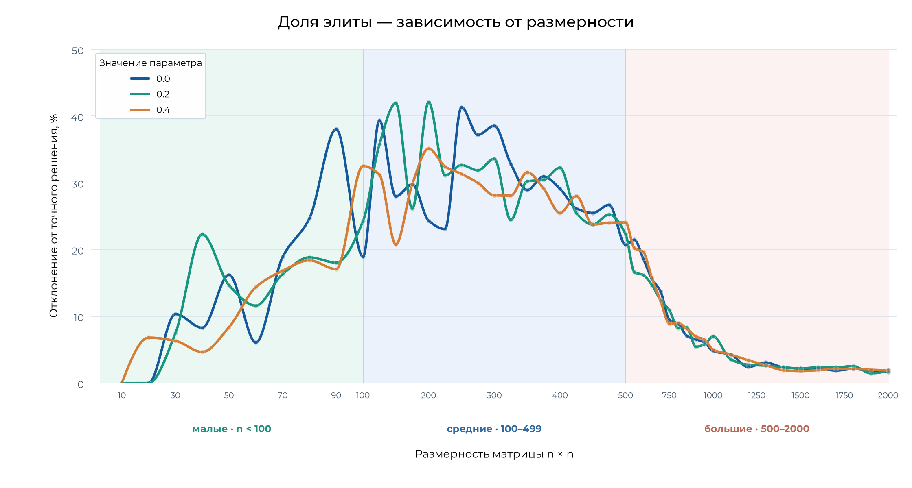

[PNG](plots/ofat_elitism_error_pct.png) · [SVG](plots/ofat_elitism_error_pct.svg) · [Время PNG](plots/ofat_elitism_seconds.png) · [Время SVG](plots/ofat_elitism_seconds.svg).

## Период локального поиска (0 = выключен)

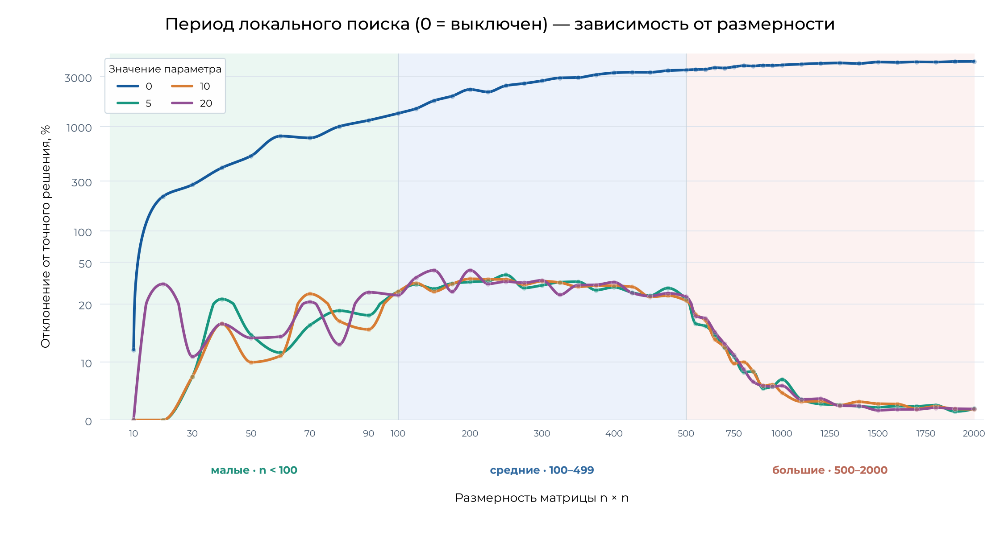

[PNG](plots/ofat_local_every_error_pct.png) · [SVG](plots/ofat_local_every_error_pct.svg) · [Время PNG](plots/ofat_local_every_seconds.png) · [Время SVG](plots/ofat_local_every_seconds.svg).

## Число кандидатов K

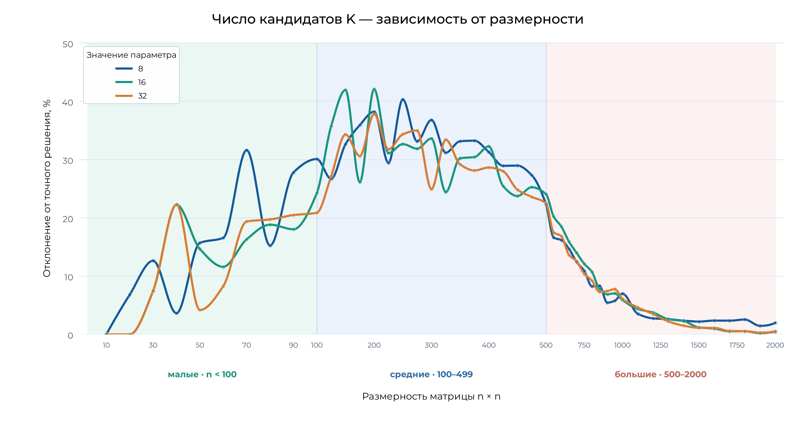

[PNG](plots/ofat_local_candidates_error_pct.png) · [SVG](plots/ofat_local_candidates_error_pct.svg) · [Время PNG](plots/ofat_local_candidates_seconds.png) · [Время SVG](plots/ofat_local_candidates_seconds.svg).

## Проходы 2-swap

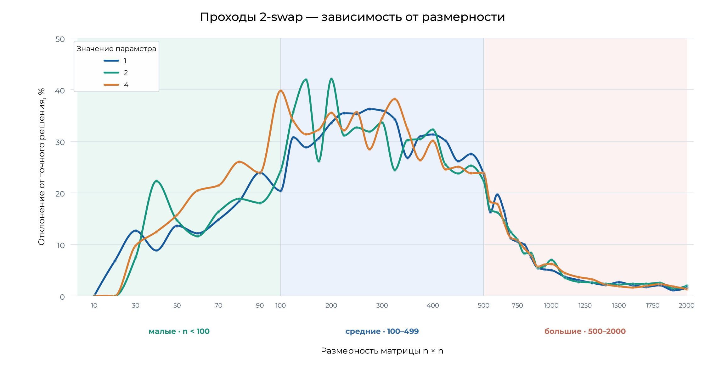

[PNG](plots/ofat_local_passes_error_pct.png) · [SVG](plots/ofat_local_passes_error_pct.svg) · [Время PNG](plots/ofat_local_passes_seconds.png) · [Время SVG](plots/ofat_local_passes_seconds.svg).

## Общее число локальных улучшений за событие

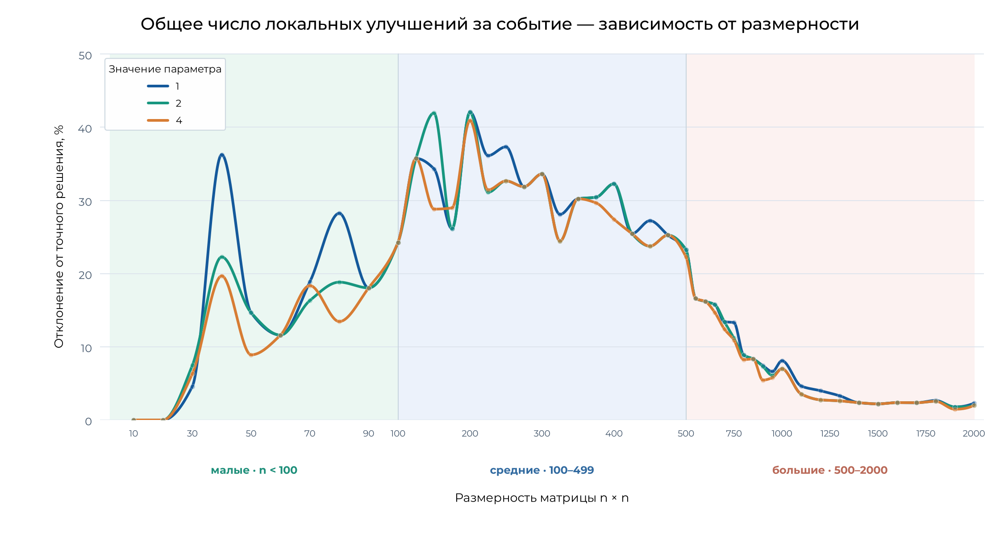

[PNG](plots/ofat_local_top_error_pct.png) · [SVG](plots/ofat_local_top_error_pct.svg) · [Время PNG](plots/ofat_local_top_seconds.png) · [Время SVG](plots/ofat_local_top_seconds.svg).

## Тройные циклы 3-cycle

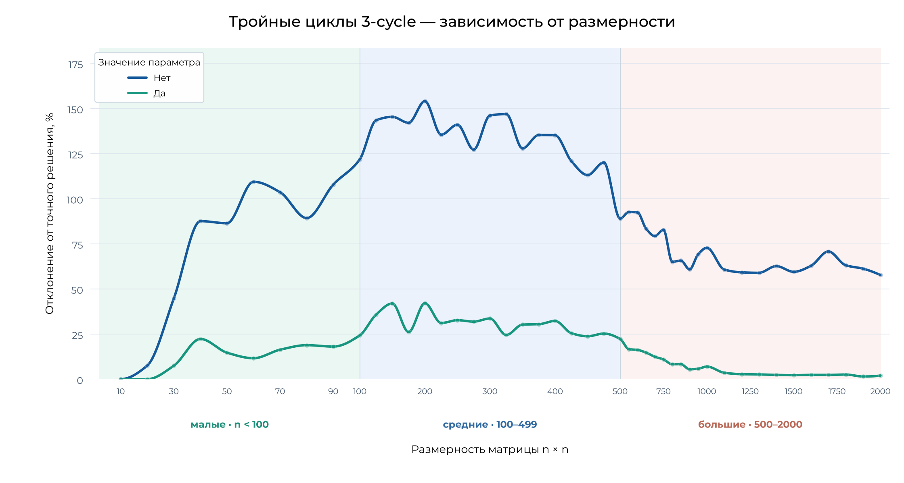

[PNG](plots/ofat_cycle3_error_pct.png) · [SVG](plots/ofat_cycle3_error_pct.svg) · [Время PNG](plots/ofat_cycle3_seconds.png) · [Время SVG](plots/ofat_cycle3_seconds.svg).

## Проходы 3-cycle

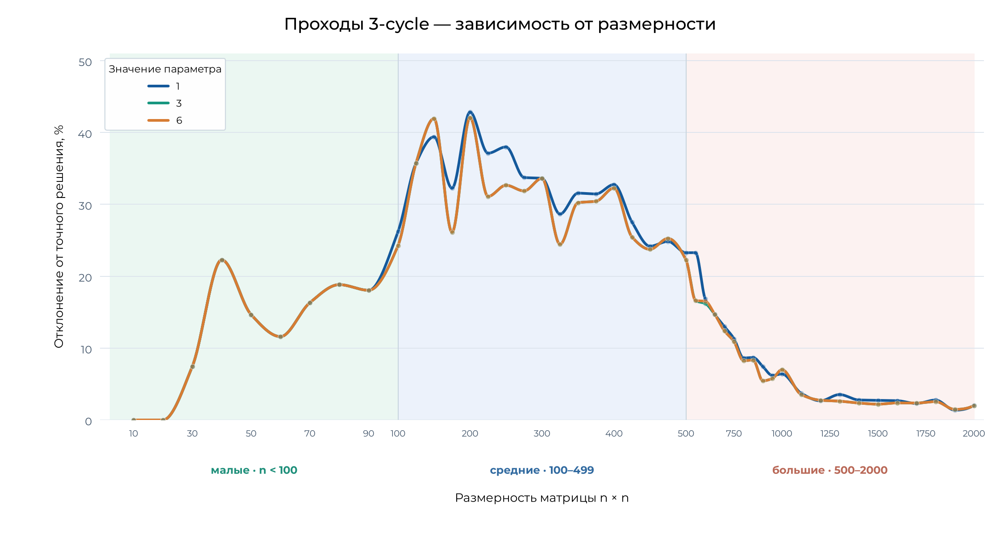

[PNG](plots/ofat_cycle3_passes_error_pct.png) · [SVG](plots/ofat_cycle3_passes_error_pct.svg) · [Время PNG](plots/ofat_cycle3_passes_seconds.png) · [Время SVG](plots/ofat_cycle3_passes_seconds.svg).

## Адаптивная инверсия

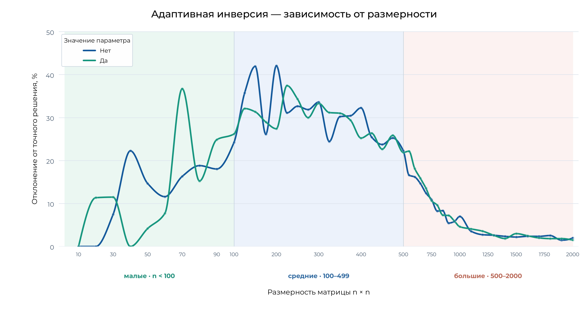

[PNG](plots/ofat_adaptive_error_pct.png) · [SVG](plots/ofat_adaptive_error_pct.svg) · [Время PNG](plots/ofat_adaptive_seconds.png) · [Время SVG](plots/ofat_adaptive_seconds.svg).

## Горизонт адаптации

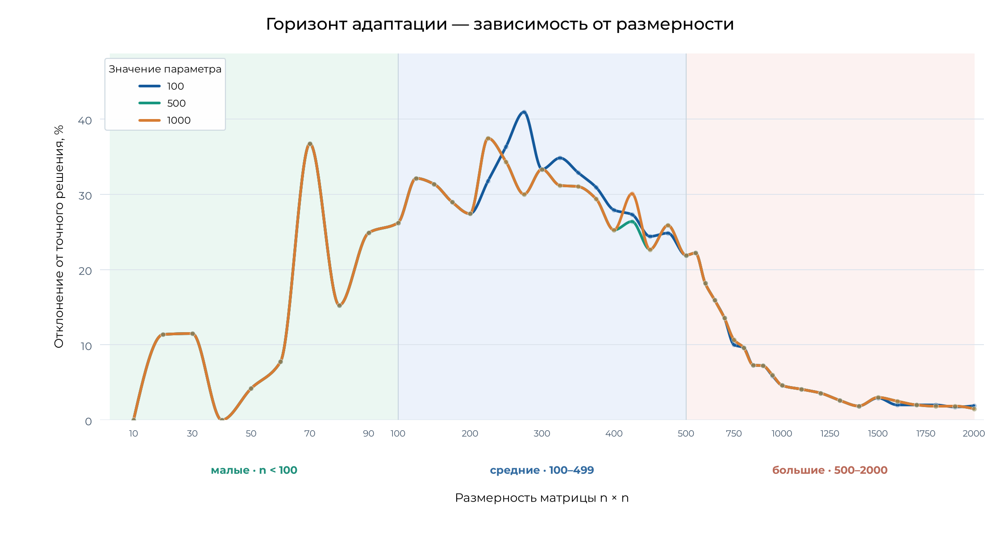

[PNG](plots/ofat_adaptive_horizon_error_pct.png) · [SVG](plots/ofat_adaptive_horizon_error_pct.svg) · [Время PNG](plots/ofat_adaptive_horizon_seconds.png) · [Время SVG](plots/ofat_adaptive_horizon_seconds.svg).

## Вероятность длинной инверсии

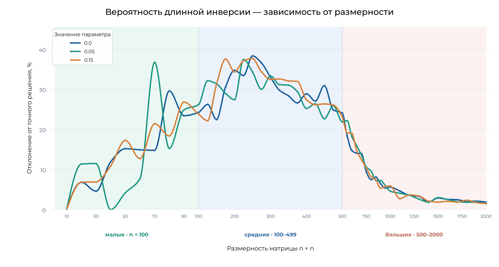

[PNG](plots/ofat_adaptive_long_prob_error_pct.png) · [SVG](plots/ofat_adaptive_long_prob_error_pct.svg) · [Время PNG](plots/ofat_adaptive_long_prob_seconds.png) · [Время SVG](plots/ofat_adaptive_long_prob_seconds.svg).

## Длина дополнительной инверсии, %

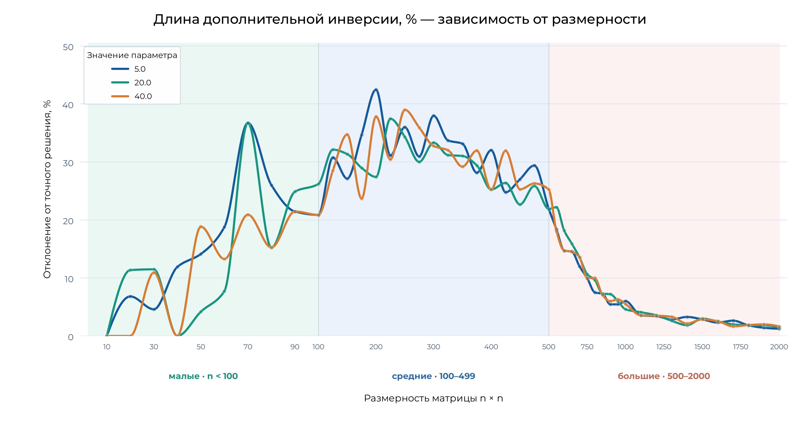

[PNG](plots/ofat_adaptive_long_pct_error_pct.png) · [SVG](plots/ofat_adaptive_long_pct_error_pct.svg) · [Время PNG](plots/ofat_adaptive_long_pct_seconds.png) · [Время SVG](plots/ofat_adaptive_long_pct_seconds.svg).

## Число островов при равной общей популяции

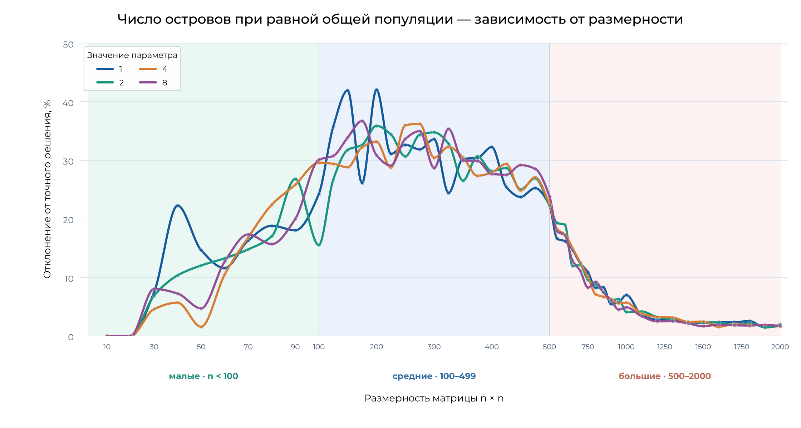

[PNG](plots/ofat_islands_error_pct.png) · [SVG](plots/ofat_islands_error_pct.svg) · [Время PNG](plots/ofat_islands_seconds.png) · [Время SVG](plots/ofat_islands_seconds.svg).

## Интервал кольцевой миграции

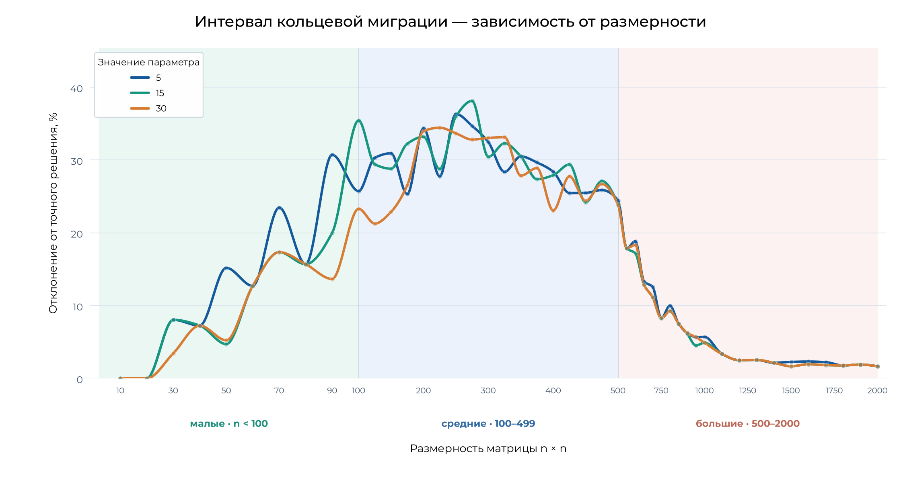

[PNG](plots/ofat_migration_interval_error_pct.png) · [SVG](plots/ofat_migration_interval_error_pct.svg) · [Время PNG](plots/ofat_migration_interval_seconds.png) · [Время SVG](plots/ofat_migration_interval_seconds.svg).

## Доля мигрантов

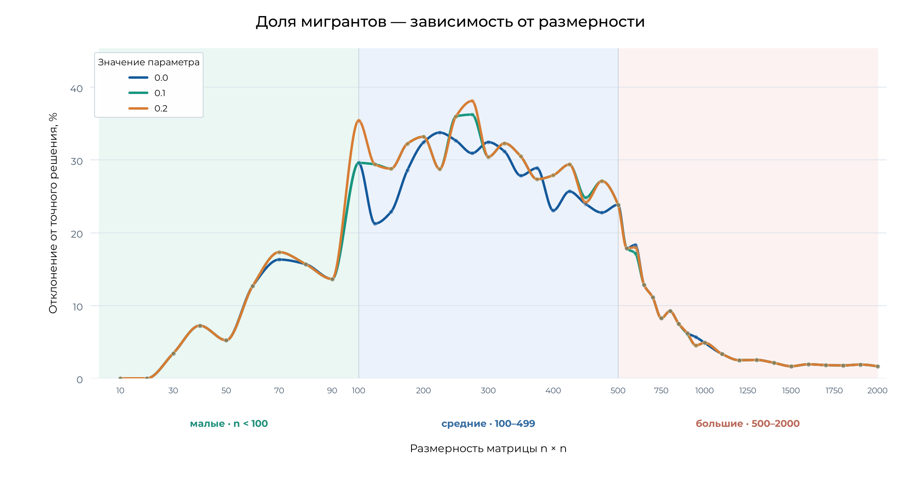

[PNG](plots/ofat_migration_pct_error_pct.png) · [SVG](plots/ofat_migration_pct_error_pct.svg) · [Время PNG](plots/ofat_migration_pct_seconds.png) · [Время SVG](plots/ofat_migration_pct_seconds.svg).

